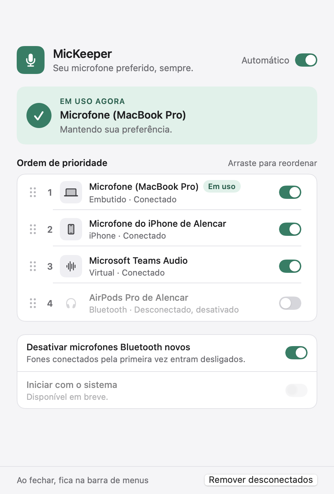

# MicKeeper

Mantém o seu microfone preferido como entrada padrão do macOS, mesmo quando um fone Bluetooth conecta e o sistema troca o microfone sozinho.

## Etapa 1: núcleo de áudio

- **`MicKeeperCore`** (biblioteca):
  - `AudioDevice` / `TransportType`: dispositivos com canais de entrada (built-in, Bluetooth, Bluetooth LE, USB, iPhone via Continuidade, virtual, agregado, outro).
  - `AudioDeviceService`: wrapper do CoreAudio atrás do protocolo `AudioSystem` (listar entradas, entrada padrão atual, definir entrada padrão, ouvir mudanças por callback ou `AsyncStream`).
  - `PriorityConfig` + `ConfigStore`: ordem de prioridade, microfones desativados e a opção "desativar automaticamente microfones Bluetooth novos" (ligada por padrão). Salvo em `~/Library/Application Support/MicKeeper/config.json`. O app se chamava MicPriority: na primeira execução, se só existir a configuração antiga (`~/Library/Application Support/MicPriority/config.json`), ela é copiada para a pasta nova.
  - `PriorityEngine.chooseDevice` e `PriorityEnforcer`: escolhe o primeiro microfone ativo e conectado na ordem de prioridade e, a cada mudança (com debounce de ~400 ms), troca a entrada padrão se necessário. Se nenhum microfone ativo estiver disponível, não mexe no sistema. Logs em `os.Logger` (subsystem `com.alencar.mickeeper`).
- **`mickeeper-cli`**: ferramenta de terminal para testar o núcleo.
- **Testes** com um `AudioSystem` simulado (sem hardware real).

Na primeira execução a ordem inicial é: built-in, USB, outros, iPhone, Bluetooth, virtual. Dispositivos vistos depois entram no fim da lista; os Bluetooth entram desativados.

## Etapa 2: janela do app



- **`MicKeeperApp`** (SwiftUI, macOS 13+): mostra o microfone em uso agora, a lista de microfones em ordem de prioridade (arraste para reordenar, chave para ativar ou desativar cada um), a chave "Automático" para pausar ou retomar a troca, a opção de desativar microfones Bluetooth novos e o botão "Remover desconectados".
- Cores e tipografia ficam em `Sources/MicKeeperApp/Theme.swift`, com variantes para modo claro e escuro (inclui os tokens do menu da barra de menus, que chega na etapa 3).
- **Uma única fonte de verdade:** o app e o CLI usam o mesmo `config.json`. Se você mudar algo pelo CLI com o app aberto, o app recarrega na hora. Com o app aberto, não precisa rodar o `watch`.
- Com a troca automática pausada, o app continua mostrando os microfones, mas não troca a entrada.

### Gerar e abrir o app

```bash
./scripts/build-app.sh
```

```bash
open build/MicKeeper.app
```

O script compila em modo release, monta `build/MicKeeper.app` (bundle `com.alencar.mickeeper`) e assina ad-hoc.

Para gerar uma imagem da janela sem precisar de permissão de Gravação de Tela:

```bash
build/MicKeeper.app/Contents/MacOS/MicKeeper --snapshot janela.png --dark
```

## Como usar o CLI

```bash
swift run mickeeper-cli list
```

```bash
swift run mickeeper-cli watch
```

```bash
swift run mickeeper-cli move <uid> <posição>
```

```bash
swift run mickeeper-cli disable <uid>
```

```bash
swift run mickeeper-cli enable <uid>
```

- `list`: mostra os microfones (com uid, tipo e qual é o padrão) e a ordem de prioridade.
- `watch`: aplica as prioridades e imprime cada evento e decisão até você apertar Ctrl+C.
- `move`: muda a posição de um microfone (1 = maior prioridade).
- `disable` / `enable`: nunca usar / voltar a usar um microfone.

Para ver os logs: `log stream --predicate 'subsystem == "com.alencar.mickeeper"' --info`

## Testes

```bash
swift test
```

## Próximas etapas

3. Modo barra de menus ao fechar a janela e iniciar com o sistema (por enquanto, fechar a janela encerra o app).
4. Empacotamento do app.
