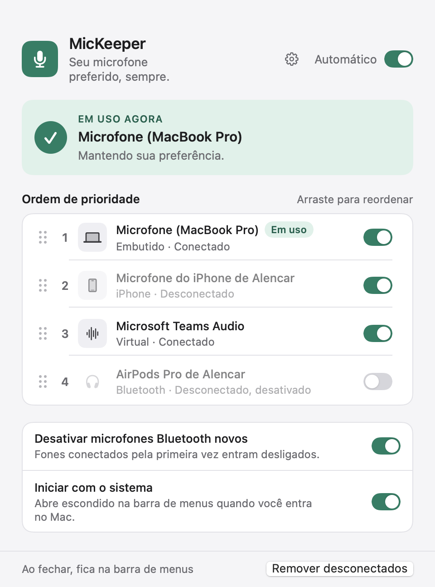
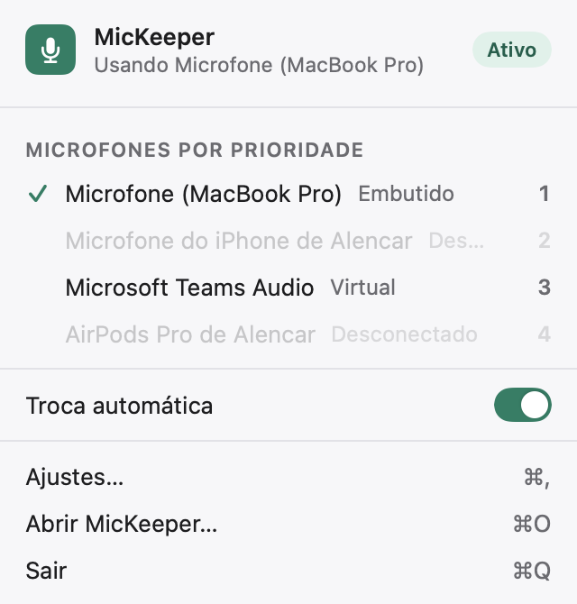
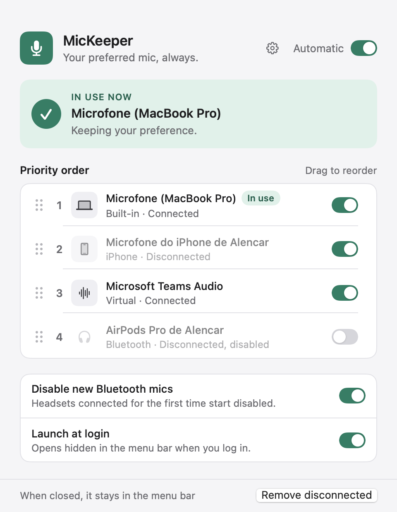

# MicKeeper

Mantém o seu microfone preferido como entrada padrão do macOS, mesmo quando um fone Bluetooth conecta e o sistema troca o microfone sozinho.

## Etapa 1: núcleo de áudio

- **`MicKeeperCore`** (biblioteca):
  - `AudioDevice` / `TransportType`: dispositivos com canais de entrada (built-in, Bluetooth, Bluetooth LE, USB, iPhone via Continuidade, virtual, agregado, outro).
  - `AudioDeviceService`: wrapper do CoreAudio atrás do protocolo `AudioSystem` (listar entradas, entrada padrão atual, definir entrada padrão, ouvir mudanças por callback ou `AsyncStream`).
  - `PriorityConfig` + `ConfigStore`: ordem de prioridade, microfones desativados e a opção "desativar automaticamente microfones Bluetooth novos" (ligada por padrão). Salvo em `~/Library/Application Support/MicKeeper/config.json`. O app se chamava MicPriority: na primeira execução, se só existir a configuração antiga (`~/Library/Application Support/MicPriority/config.json`), ela é copiada para a pasta nova.
  - `PriorityEngine.chooseDevice` e `PriorityEnforcer`: escolhe o primeiro microfone ativo e conectado na ordem de prioridade e, a cada mudança (com debounce de ~400 ms), troca a entrada padrão se necessário. Se nenhum microfone ativo estiver disponível, não mexe no sistema. Logs em `os.Logger` (subsystem `com.alencar.mickeeper`).
- **`mickeeper-cli`**: ferramenta de terminal para testar o núcleo.
- **Testes** com um `AudioSystem` simulado (sem hardware real).

Na primeira execução a ordem inicial é: built-in, USB, outros, iPhone, Bluetooth, virtual. Dispositivos vistos depois entram no fim da lista; os Bluetooth entram desativados.

## Etapa 2: janela do app



- **`MicKeeperApp`** (SwiftUI, macOS 13+): mostra o microfone em uso agora, a lista de microfones em ordem de prioridade (arraste para reordenar, chave para ativar ou desativar cada um), a chave "Automático" para pausar ou retomar a troca, a opção de desativar microfones Bluetooth novos e o botão "Remover desconectados".
- Cores e tipografia ficam em `Sources/MicKeeperApp/Theme.swift`, com variantes para modo claro e escuro (a janela e o menu da barra de menus usam os mesmos tokens).
- **Uma única fonte de verdade:** o app e o CLI usam o mesmo `config.json`. Se você mudar algo pelo CLI com o app aberto, o app recarrega na hora. Com o app aberto, não precisa rodar o `watch`.
- Com a troca automática pausada, o app continua mostrando os microfones, mas não troca a entrada.

## Etapa 3: barra de menus e iniciar com o sistema



- **Barra de menus:** o ícone de microfone fica sempre na barra (riscado quando a troca automática está pausada). O menu mostra o microfone em uso, o status Ativo/Pausado, os microfones por prioridade, a chave "Troca automática", "Abrir MicKeeper…" (⌘O) e "Sair" (⌘Q).
- **Clicar num microfone no menu** faz dele o nº 1 da lista (e o ativa), então ele passa a ser usado na hora e continua sendo o preferido. Com a troca pausada, ele também vira a entrada padrão na hora.
- **Fechar a janela não encerra o app:** ele continua na barra de menus e o ícone do Dock some. Só "Sair" encerra.
- **Iniciar com o sistema** usa o `SMAppService` do macOS. Ao abrir no login, o app começa só na barra de menus, sem janela. Se o macOS pedir aprovação, aparece um botão para abrir Ajustes do Sistema › Itens de Início.
- A janela tem largura fixa e a altura acompanha a lista; com mais de 7 microfones, só a lista rola.

## Idiomas e ajustes



- A interface está em **português (Brasil), inglês e espanhol**. Os textos ficam em `Sources/MicKeeperCore/Resources/<idioma>.lproj/Localizable.strings`; os nomes dos microfones vêm do sistema e não são traduzidos.
- **Ajustes** (⌘, ou o botão de engrenagem na janela, ou "Ajustes…" no menu da barra de menus) tem o seletor de **Idioma**: "Automático (idioma do sistema)", "Português (Brasil)", "English" ou "Español". A troca vale na hora, sem reiniciar. No automático, o app segue o idioma do macOS (inclusive o idioma escolhido só para o MicKeeper em Ajustes do Sistema › Geral › Idioma e Região) e usa inglês se o idioma do sistema não for um dos três.
- Um teste garante que toda chave existe nos três idiomas e que os `%@`/`%d` batem.

### Gerar, instalar e abrir o app

```bash
./scripts/build-app.sh --install
```

```bash
open ~/Applications/MicKeeper.app
```

O script compila em modo release, monta `build/MicKeeper.app` (bundle `com.alencar.mickeeper`), assina ad-hoc e, com `--install`, copia para `~/Applications/MicKeeper.app` (não precisa de administrador). Use a cópia instalada para "Iniciar com o sistema": a pasta `build/` é apagada a cada build, e o macOS registra o app pelo caminho dele.

Para gerar uma imagem da janela sem precisar de permissão de Gravação de Tela:

```bash
build/MicKeeper.app/Contents/MacOS/MicKeeper --snapshot janela.png --dark
```

Com `--popover` a imagem é do menu da barra de menus, com `--settings` é a janela de Ajustes, e `--lang en` (ou `es`, `pt-BR`) escolhe o idioma só para a imagem. Para abrir só na barra de menus (como no login):

```bash
open ~/Applications/MicKeeper.app --args --hidden
```

## Como usar o CLI

```bash
swift run mickeeper-cli list
```

```bash
swift run mickeeper-cli watch
```

```bash
swift run mickeeper-cli move <uid> <posição>
```

```bash
swift run mickeeper-cli disable <uid>
```

```bash
swift run mickeeper-cli enable <uid>
```

- `list`: mostra os microfones (com uid, tipo e qual é o padrão) e a ordem de prioridade.
- `watch`: aplica as prioridades e imprime cada evento e decisão até você apertar Ctrl+C.
- `move`: muda a posição de um microfone (1 = maior prioridade).
- `disable` / `enable`: nunca usar / voltar a usar um microfone.

Para ver os logs: `log stream --predicate 'subsystem == "com.alencar.mickeeper"' --info`

## Testes

```bash
swift test
```

## Próximas etapas

4. Empacotamento do app.
